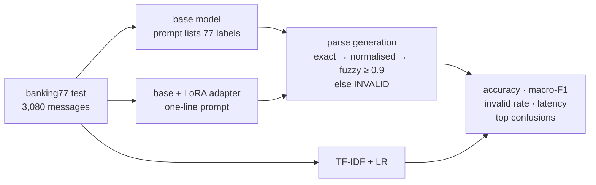

# llm-finetune-lab

[](https://github.com/joaofrancowork/llm-finetune-lab/actions/workflows/ci.yml)


**Does fine-tuning a small open LLM pay off, and against what?** LoRA supervised fine-tuning of
**Qwen2.5-0.5B-Instruct** for intent classification on **banking77** (77 intents, real
customer-support messages), evaluated on the full test set (3,080 messages) before and after
training, and against a classical baseline. Trained locally on an Apple M4 Pro in 12 minutes.

## Results

| Model | Accuracy | Macro-F1 | Invalid outputs | ms / example |
|---|---|---|---|---|
| Qwen2.5-0.5B-Instruct, zero-shot (all 77 labels in the prompt) | 15.5% | 14.6% | 35.8% | 88.8 |
| **Qwen2.5-0.5B-Instruct + LoRA** (one-line prompt) | **90.8%** | **90.9%** | **0.1%** | 17.2 |
| TF-IDF + logistic regression | 91.0% | 91.0% | 0.0% | 0.1 |

*Latency: batched greedy decoding on Apple MPS for the LLM, CPU for the baseline.*

**What fine-tuning bought.** +75 points of accuracy. Before training, the base model answers
with something that is not a label more than a third of the time (`track_code`,
`automate_top_up`), and otherwise falls back on a few generic intents. After one epoch of LoRA
(1.75% of the parameters), invalid outputs drop to 3 in 3,080. The prompt also shrinks from
430 tokens (the label list) to 31, which makes it **5x faster** per example.

**What it did not buy.** Parity, not victory: a TF-IDF + logistic regression baseline trained on
the same 9k examples scores 91.0%, at about 0.1 ms per message. With a closed label set and
thousands of labelled examples, the classical model is the better production choice. The two
models also make the same kind of mistakes, between intents that are hard to tell apart
(`card_arrival` vs `card_delivery_estimate`, `verify_my_identity` vs `why_verify_identity`).

**When the LLM route is worth it.** Few or no labels (where the classical model cannot learn),
labels that change often, or an assistant that has to *also* talk to the customer. Then the same
adapter recipe applies, and this repo measures it against the baseline before deciding.

Full report with the most frequent errors per model: [docs/results.md](docs/results.md). Training
log: [docs/training.json](docs/training.json).

## Recipe

| | |
|---|---|
| Base model | `Qwen/Qwen2.5-0.5B-Instruct` (Apache 2.0, 494M parameters) |
| Data | banking77 (CC BY 4.0): 10,003 train → 9,002 train + 1,001 validation (stratified), 3,080 test |
| LoRA | r = 16, α = 32, dropout 0.05, on all attention and MLP projections: **8.8M trainable (1.75%)** |
| Optimisation | AdamW, lr 2e-4, cosine with 5% warm-up, 1 epoch, batch 8 × 2 accumulation, grad clip 1.0 |
| Memory | bf16 weights + gradient checkpointing (fp32 at batch 16 hit 19 GB and swapped on 24 GB) |
| Loss | on the answer tokens only (prompt tokens masked with −100) |
| Result | train loss 1.93 → 0.01, validation loss 0.080, 563 steps in 11.8 min on Apple MPS |

The training loop is plain PyTorch ([`train.py`](src/finetune_lab/train.py)), not `Trainer`,
so the whole recipe fits on one screen: masking, schedule, clipping, seeding.

## Evaluation design



- **Invalid outputs are counted, not hidden.** A generation is mapped to a label only by exact
  match, normalisation (case, spaces, quotes, an `Intent:` prefix) or a very close fuzzy match
  (≥ 0.9). Anything else is `INVALID` and counts as wrong, so the invalid rate is reported.
- **Same test set, same parser** for both LLM settings; greedy decoding for reproducibility.
- **A baseline first.** The classical model runs in CI on the real data as a regression gate.

## Reproduce

```bash
git clone https://github.com/joaofrancowork/llm-finetune-lab && cd llm-finetune-lab
uv sync --extra train
uv run ft-lab baseline     # ~1 min on CPU
uv run ft-lab zero-shot    # base model, full test set
uv run ft-lab train        # LoRA, ~12 min on an M-series Mac; minutes on a CUDA GPU
uv run ft-lab finetuned    # evaluate the adapter
uv run ft-lab report       # writes docs/results.md
```

`docker build -t ft-lab . && docker run --gpus all ft-lab train` trains on a CUDA GPU (cloud VM or
a managed job). `--limit N` evaluates on the first N test messages for quick iterations.

## Roadmap

- [ ] Few-shot prompting and constrained decoding (score each label's likelihood) as stronger
      no-training baselines
- [ ] Learning curve: accuracy vs number of labelled examples per intent (where LoRA should beat
      TF-IDF)
- [ ] QLoRA on a 1.5B–3B model on a CUDA GPU
- [ ] Serve the merged model with vLLM and measure throughput

## License

MIT. Model: Apache 2.0 (Qwen). Data: CC BY 4.0, Casanueva et al., *Efficient Intent Detection
with Dual Sentence Encoders*, 2020.
